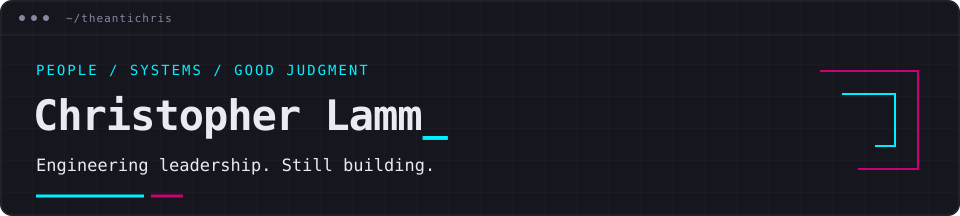

# Hey, y'all. I'm Christopher.

I'm a **Senior Engineering Manager at [CompanyCam](https://companycam.com)**, leading Data Engineering, Machine Learning, and AI Engineering. I build teams, develop leaders, and help turn technical decisions into useful products.

Previously, I held Director of Software Engineering roles at The Art of Education University and KXVL Software. I've been writing software since I was 12. I still like making things that make people's lives, including mine, a little better.

[Website](https://theantichris.com/) · [Résumé](https://theantichris.com/resume/) · [Writing](https://theantichris.com/posts/) · [LinkedIn](https://www.linkedin.com/in/theantichris/)

## People, then systems

My job is to make sure people *can* do their jobs: give them context, clear ownership, room to grow, and support when they need it.

- **Build the organization:** I've built engineering teams, shaped hiring and career expectations, and mentored engineers into management.
- **Connect strategy to delivery:** I work across engineering and product on AI, data platforms, and modernization, with attention to what we should build and why.
- **Make good judgment repeatable:** Write things down, explain tradeoffs, verify results, and measure outcomes instead of busyness.

My [Remote Manager Playbook](https://github.com/theantichris/remote-manager-playbook) puts that approach into practical guides and templates.

## On my workbench

| Project | What you'll find |
| --- | --- |
| [Ghost](https://github.com/theantichris/ghost) | A local-first AI companion in Go, powered by Ollama. Being rebuilt as a terminal cyberdeck. |
| [Granola CLI](https://github.com/theantichris/granola) | Export Granola notes and transcripts to local files for backup, migration, and offline access. |
| [Dotfiles](https://github.com/theantichris/dotfiles) | My Linux environment, chezmoi configuration, and a shared cyberpunk palette for life in the terminal. |
| [Remote Manager Playbook](https://github.com/theantichris/remote-manager-playbook) | How I lead distributed teams: shared context, honest feedback, sustainable work, and growth. |

Mostly Go, Linux, shell scripts, and Markdown outside work. Sometimes a [cyberpunk roguelike](https://github.com/theantichris/sprawlrunner), because not everything needs a business case.

## Pull up a terminal

Try a tool, fork something to fit your workflow, or open an issue or PR with a concrete example. Bug reports, documentation fixes, and practical additions to the playbook are all welcome.

If something is useful, give it a star so others can find it. Follow along for tools, terminal experiments, and thoughts on engineering leadership.

Based in Knoxville, Tennessee. Husband, dad, reader, biker, and enthusiastic homebody. Pretty ok guy.
